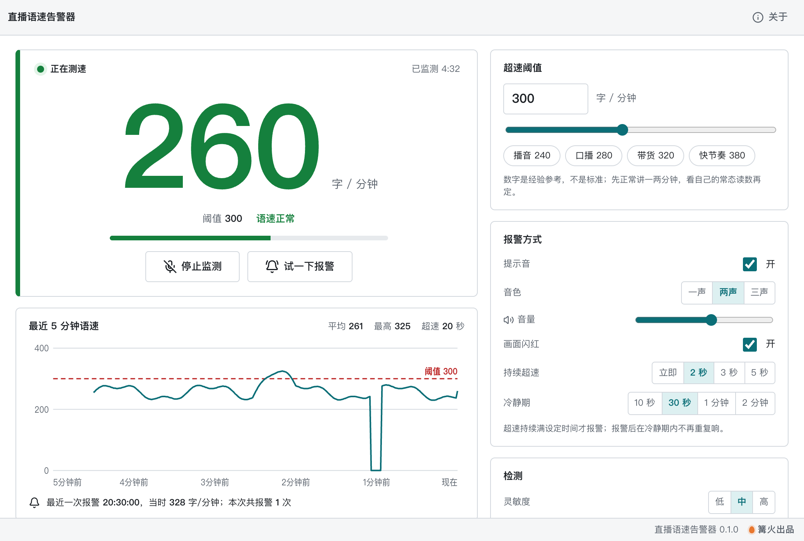

# 直播语速告警器

> 篝火出品 · 收录于篝火 App 应用区

直播时实时测说话快慢，太快就响铃提醒，纯本地不录音



## 下载

到 [Releases](https://github.com/campfire-code/live-speech-pace/releases/latest) 下载对应安装包：

| 电脑 | 文件 |
|---|---|
| Windows 10 / 11 | `live-speech-pace_版本号_windows-x64-setup.exe` |
| Mac（Apple 芯片） | `live-speech-pace_版本号_mac-arm64.dmg` |
| Mac（Intel 芯片） | `live-speech-pace_版本号_mac-x64.dmg` |

第一次打开：
- **Windows**：如果弹出「Windows 已保护你的电脑」，点「更多信息」→「仍要运行」。
- **Mac**：如果提示「无法验证开发者」，打开「系统设置 → 隐私与安全性」，在下方点「仍要打开」。

## 怎么用

> 隐私：麦克风的声音只在本机内存里即时计算，不录音、不保存、不联网、不上传。

1. 点「开始监测」，第一次会弹出麦克风授权，选允许。
   - **Mac**：如果之前点过「不允许」，到「系统设置 → 隐私与安全性 → 麦克风」勾选本软件，重新打开。
   - **Windows**：弹出提示时点「允许」；若被拒绝，到「设置 → 隐私和安全性 → 麦克风」，打开「允许桌面应用访问麦克风」。
2. 正常讲话，窗口中间的大数字就是当前语速（字 / 分钟）。原理是数说话声音的起伏次数，中文一个字约一次起伏，所以是估算值，不是逐字识别。
3. 在右侧设置「超速阈值」。先正常讲一两分钟，看自己的常态读数，再把阈值定在常态上方一点。预设的「播音 240、口播 280、带货 320、快节奏 380」只是经验参考。
4. 语速持续超过阈值（默认满 2 秒）时，响铃并让画面闪红；报警后进入冷静期（默认 30 秒），期间不重复响。
5. 下方曲线是最近 5 分钟的语速，虚线是阈值，并统计平均、最高和超速秒数。
6. 数字偏低或漏字，把「灵敏度」调高；背景杂音被误数，调低。点「试一下报警」可以试听音量和画面效果。

注意：建议用耳麦或贴近嘴的麦克风；开着外放时，电脑播放的声音也会被数进去。音频处理按采样点时间计算，窗口放到后台、最小化也不会停。

## 验收用例

`samples/` 里是合成的示例音频（嗡嗡声模拟每秒 N 个字，不是真人说话）。用电脑外放、麦克风离扬声器约 20 厘米，音量调到中等，在安静环境下操作：

| 操作 | 应得到 |
|---|---|
| 点「开始监测」，播放 `示例-每秒4字-约240字每分钟.wav` | 约 5 秒后读数稳定在 240 附近（允许偏差，受扬声器和麦克风影响），阈值 300 时状态为「语速正常」 |
| 保持监测，改为播放 `示例-每秒6字-约360字每分钟.wav` | 读数升到 360 附近，状态「语速过快！」；持续 2 秒后响两声并画面闪红，曲线下方「最近一次报警」出现时间与读数 |
| 继续播放 30 秒内 | 不再响（冷静期），曲线上有一段越过虚线；30 秒后仍超速则再响一次 |
| 停止播放，等 5 秒 | 读数归零，状态「等待说话…」 |
| 点「试一下报警」 | 立刻响铃并闪红 4 秒，不需要麦克风 |
| 不允许麦克风授权 | 界面显示「没有麦克风权限…」及打开系统设置的路径，不会崩溃 |

单元测试（`pnpm test`）用同样的合成音频在代码里校验：每秒 4 / 5 / 6 字读数分别约 240 / 300 / 360，底噪与 50Hz 嗡嗡声读数为 0，以及报警持续时间与冷静期的判定。

## 自己编译

需要 Node.js 22、pnpm、Rust。

```bash
pnpm install
pnpm test          # 单元测试
pnpm tauri dev     # 开发运行
pnpm tauri build   # 打包
```

界面框架在 `src/kit`（所有 campfire-code 工具共用），本工具的逻辑在 `src/tool`。

## 归属

本工具由**篝火**出品，是篝火 App 应用区收录的开源工具之一，由篝火（GitHub 组织 [campfire-code](https://github.com/campfire-code)）维护与更新。全部工具的目录见 [toolkit-hub](https://github.com/campfire-code/toolkit-hub)。

## 许可证

MIT，版权方为篝火（campfire-code）。
